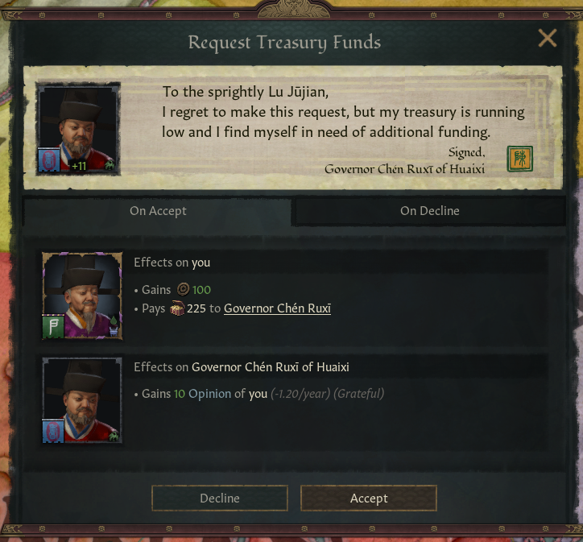

# Ministry event and interaction design

User-approved visual reference: CK3's native **Request Treasury Funds** interaction, supplied on 2026-10-28.

## Preferred presentation

- Use the native correspondence layout for petitions, funding requests, consent, approval and appeals when the interaction system supports the required flow. A letter, character portrait and signature establish who is addressing whom.
- Write one short, natural paragraph explaining the request and its purpose. Use the speaker's voice. Keep administrative rules and detailed calculations in tooltips.
- Use linked character names and recognizable office/title names. Make the payer, recipient and requested amount unambiguous.
- Group consequences by affected character, following the native **Effects on you** and **Effects on [character]** presentation. Include portraits where the native layout provides them.
- Prefer native treasury, Influence, opinion, hook and stress formatting. Show actual amounts, positive/negative coloring and relevant durations. Trait consequences appear only when the deciding character has that trait and the condition applies.
- Give the player clear action buttons: accept, decline, submit for approval, return for revision or uphold an appeal, according to what the action actually does.
- Preserve this restrained parchment, dark-panel and gold-accent style. Use the game's existing typography, spacing, borders and assets.

## Match the interface to the action

| Situation | Preferred treatment |
|---|---|
| One official asks another for money or consent | Native interaction letter with accept/decline previews |
| A superior decides a submitted recommendation | Correspondence and grouped consequences; identify the actual public payer |
| Several substantive alternatives must be compared | Character event with concise prose, portraits and clearly explained options |
| A completed or refused action is reported | Brief result correspondence with the actual outcome; detailed account readings belong in its explanatory tooltip where practical |
| Standing authority and payment limits | Realm law panel with native icons and per-level effects; short contextual explanations elsewhere |

An agreement to contribute and final authorization are distinct stages. A letter awaiting approval must not preview an immediate completed payment. A budget change affects future receipts and must not be presented as a lump-sum transfer.

## Implementation rules

- Prefer native layouts and effect previews before adding custom GUI.
- Native previews must describe the actual action at that stage. Tooltip-only effects must never execute a second payment, spend a hook or apply stress.
- Keep financial execution in the guarded Revenue commit helper. Presentation changes must preserve consent, authority, account identity, queues and duplicate-payment protection.
- Event-dependent names, amounts and result selectors must retain event scope. Use native scripted event descriptions and direct event localization for that data; character-only `Custom()` localization lost these scopes in the dev.47 playtest.
- Missing result data must never fall back to a success statement.
- Avoid title-only notices, long technical explanations in dialogue, unrelated trait warnings and dense repeated rule lists.

## Status

This document records the design language for subsequent ministry work. The reference image is the native interaction request interface; it is not a new theme that can simply be assigned to every character event. Existing Revenue screens have not all been converted to this layout. Their conversion and in-game visual verification remain pending.

Recording this preference does not modify Personnel gameplay, Revenue transactions or vanilla files.
